<h1 align="center">Personajes del IPD</h1>

  <a href="sprites/gen1_rulito.svg">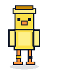</a>
  <a href="sprites/gen5_rl.svg">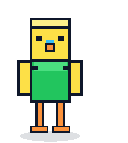</a>
  <a href="sprites/gen3_gary.svg">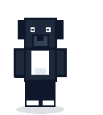</a>

<strong>27 personajes · 54 sprites vectoriales</strong> Dibujados por Alonso Toro para el Dilema del Prisionero Iterado.

<a href="#el-elenco">El elenco</a> · <a href="#usar-los-sprites">Usar los sprites</a> · <a href="https://alonsuh.duckdns.org/ipd/">Ver el proyecto original</a>

Rulito es un canario Fiorino, Mitcha un periquito verde y Gary un perro negro y blanco. En el IPD, los personajes ayudan a reconocer qué estrategia está jugando en cada turno.

## El elenco

### Agentes del proyecto

<table>
<tr>
  <td align="center"> <strong>Rulito</strong> <a href="sprites/gen1_rulito.svg">Cuerpo</a> · <a href="sprites/gen1_rulito-retrato.svg">Retrato</a></td>
  <td align="center"><a href="sprites/gen2_cloud.svg">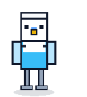</a> <strong>Cloud</strong> <a href="sprites/gen2_cloud.svg">Cuerpo</a> · <a href="sprites/gen2_cloud-retrato.svg">Retrato</a></td>
  <td align="center"> <strong>Gary</strong> <a href="sprites/gen3_gary.svg">Cuerpo</a> · <a href="sprites/gen3_gary-retrato.svg">Retrato</a></td>
</tr>
<tr>
  <td align="center"><a href="sprites/gen4_base.svg">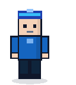</a> <strong>Base CDDC</strong> <a href="sprites/gen4_base.svg">Cuerpo</a> · <a href="sprites/gen4_base-retrato.svg">Retrato</a></td>
  <td align="center"> <strong>Mitcha</strong> <a href="sprites/gen5_rl.svg">Cuerpo</a> · <a href="sprites/gen5_rl-retrato.svg">Retrato</a></td>
  <td align="center"><a href="sprites/gen6_jacinto.svg">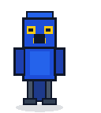</a> <strong>Jacinto</strong> <a href="sprites/gen6_jacinto.svg">Cuerpo</a> · <a href="sprites/gen6_jacinto-retrato.svg">Retrato</a></td>
</tr>
</table>

### Jugador, rivales y estrategias del torneo

<table>
<tr>
  <td align="center"><a href="sprites/human.svg">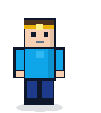</a> <strong>Jugador humano</strong> <a href="sprites/human.svg">Cuerpo</a> · <a href="sprites/human-retrato.svg">Retrato</a></td>
  <td align="center"><a href="sprites/axl_TitForTat.svg">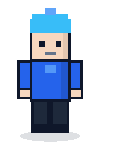</a> <strong>Tit For Tat</strong> <a href="sprites/axl_TitForTat.svg">Cuerpo</a> · <a href="sprites/axl_TitForTat-retrato.svg">Retrato</a></td>
  <td align="center"><a href="sprites/axl_FirstByTidemanAndChieruzzi.svg">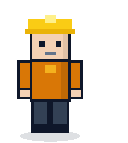</a> <strong>First By Tideman And Chieruzzi</strong> <a href="sprites/axl_FirstByTidemanAndChieruzzi.svg">Cuerpo</a> · <a href="sprites/axl_FirstByTidemanAndChieruzzi-retrato.svg">Retrato</a></td>
</tr>
<tr>
  <td align="center"><a href="sprites/axl_FirstByNydegger.svg">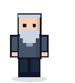</a> <strong>First By Nydegger</strong> <a href="sprites/axl_FirstByNydegger.svg">Cuerpo</a> · <a href="sprites/axl_FirstByNydegger-retrato.svg">Retrato</a></td>
  <td align="center"> <strong>First By Grofman</strong> <a href="sprites/axl_FirstByGrofman.svg">Cuerpo</a> · <a href="sprites/axl_FirstByGrofman-retrato.svg">Retrato</a></td>
  <td align="center"><a href="sprites/axl_FirstByShubik.svg">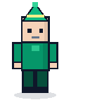</a> <strong>First By Shubik</strong> <a href="sprites/axl_FirstByShubik.svg">Cuerpo</a> · <a href="sprites/axl_FirstByShubik-retrato.svg">Retrato</a></td>
</tr>
<tr>
  <td align="center"><a href="sprites/axl_FirstBySteinAndRapoport.svg">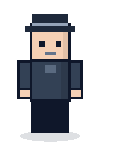</a> <strong>First By Stein And Rapoport</strong> <a href="sprites/axl_FirstBySteinAndRapoport.svg">Cuerpo</a> · <a href="sprites/axl_FirstBySteinAndRapoport-retrato.svg">Retrato</a></td>
  <td align="center"><a href="sprites/axl_Grudger.svg">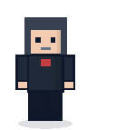</a> <strong>Grudger</strong> <a href="sprites/axl_Grudger.svg">Cuerpo</a> · <a href="sprites/axl_Grudger-retrato.svg">Retrato</a></td>
  <td align="center"><a href="sprites/axl_FirstByDavis.svg">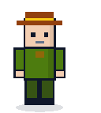</a> <strong>First By Davis</strong> <a href="sprites/axl_FirstByDavis.svg">Cuerpo</a> · <a href="sprites/axl_FirstByDavis-retrato.svg">Retrato</a></td>
</tr>
<tr>
  <td align="center"><a href="sprites/axl_FirstByGraaskamp.svg">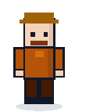</a> <strong>First By Graaskamp</strong> <a href="sprites/axl_FirstByGraaskamp.svg">Cuerpo</a> · <a href="sprites/axl_FirstByGraaskamp-retrato.svg">Retrato</a></td>
  <td align="center"><a href="sprites/axl_FirstByDowning.svg">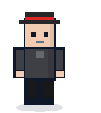</a> <strong>First By Downing</strong> <a href="sprites/axl_FirstByDowning.svg">Cuerpo</a> · <a href="sprites/axl_FirstByDowning-retrato.svg">Retrato</a></td>
  <td align="center"><a href="sprites/axl_FirstByFeld.svg">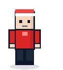</a> <strong>First By Feld</strong> <a href="sprites/axl_FirstByFeld.svg">Cuerpo</a> · <a href="sprites/axl_FirstByFeld-retrato.svg">Retrato</a></td>
</tr>
<tr>
  <td align="center"><a href="sprites/axl_FirstByJoss.svg">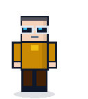</a> <strong>First By Joss</strong> <a href="sprites/axl_FirstByJoss.svg">Cuerpo</a> · <a href="sprites/axl_FirstByJoss-retrato.svg">Retrato</a></td>
  <td align="center"><a href="sprites/axl_FirstByTullock.svg">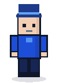</a> <strong>First By Tullock</strong> <a href="sprites/axl_FirstByTullock.svg">Cuerpo</a> · <a href="sprites/axl_FirstByTullock-retrato.svg">Retrato</a></td>
  <td align="center"><a href="sprites/axl_FirstByAnonymous.svg">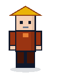</a> <strong>First By Anonymous</strong> <a href="sprites/axl_FirstByAnonymous.svg">Cuerpo</a> · <a href="sprites/axl_FirstByAnonymous-retrato.svg">Retrato</a></td>
</tr>
<tr>
  <td align="center"><a href="sprites/axl_Random.svg">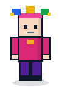</a> <strong>Random</strong> <a href="sprites/axl_Random.svg">Cuerpo</a> · <a href="sprites/axl_Random-retrato.svg">Retrato</a></td>
  <td align="center"><a href="sprites/axl_Defector.svg">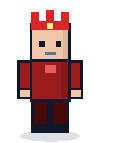</a> <strong>Defector</strong> <a href="sprites/axl_Defector.svg">Cuerpo</a> · <a href="sprites/axl_Defector-retrato.svg">Retrato</a></td>
  <td align="center"><a href="sprites/axl_Cooperator.svg">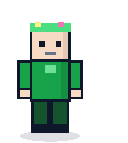</a> <strong>Cooperator</strong> <a href="sprites/axl_Cooperator.svg">Cuerpo</a> · <a href="sprites/axl_Cooperator-retrato.svg">Retrato</a></td>
</tr>
<tr>
  <td align="center"><a href="sprites/axl_Alternator.svg">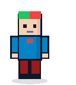</a> <strong>Alternator</strong> <a href="sprites/axl_Alternator.svg">Cuerpo</a> · <a href="sprites/axl_Alternator-retrato.svg">Retrato</a></td>
  <td align="center"><a href="sprites/rival_switch_50.svg">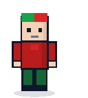</a> <strong>Cambio C → D</strong> <a href="sprites/rival_switch_50.svg">Cuerpo</a> · <a href="sprites/rival_switch_50-retrato.svg">Retrato</a></td>
  <td align="center"><a href="sprites/rival_3phase.svg">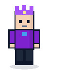</a> <strong>Tres fases C → D → C</strong> <a href="sprites/rival_3phase.svg">Cuerpo</a> · <a href="sprites/rival_3phase-retrato.svg">Retrato</a></td>
</tr>
</table>

## Usar los sprites

Cada personaje tiene un SVG de cuerpo completo y un retrato, ambos con fondo transparente. El [catálogo JSON](personajes.json) reúne los identificadores y las rutas. La [galería HTML](index.html) se puede abrir localmente en un navegador.

### Un retrato en una conversación

<table>
<tr>
  <td>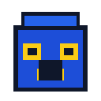</td>
  <td><strong>Jacinto</strong> ¿Jugamos una ronda?</td>
</tr>
</table>

~~~html

<strong>Jacinto</strong>

¿Jugamos una ronda?

~~~

El [renderizador original](src/personajes.js) permite generar SVG con distintas expresiones y poses.

~~~html

~~~
